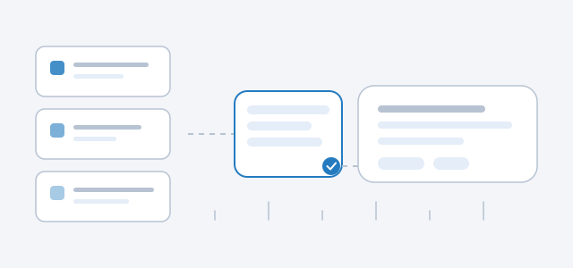

# dsh-sift-kb

[](https://github.com/anheon/dsh-sift-kb/blob/main/LICENSE)
[](#系统要求)
[](https://github.com/anheon/dsh-sift-kb)
[](https://www.npmjs.com/package/dsh-sift-kb)

把本机的 [sift](https://pypi.org/project/sift-rag/) 知识库接进 **DeepSeek Harness（DSH）**。装好后，DSH 侧栏会多出一个「知识库」面板：你可以在里面启动/停止 sift、检索资料、导入课件，Agent 也能通过 `sift_kb` 工具和 `mcp__sift__*` 使用你的知识库。

> **这个插件不包含 sift，也不包含你的资料。** 它负责把已经装好的 sift 服务、DSH 面板和导入流程连接起来；资料始终留在你自己的电脑上。



## 不想自己配置？让 Agent 帮你部署

这个插件就是给 DSH 用的，所以最省事的方式是**让 DSH 里的 Agent 帮你装**。把下面整段话复制给 Agent：

```text
请帮我在这台 Windows 电脑上部署 DSH 插件 dsh-sift-kb
（https://github.com/anheon/dsh-sift-kb），装好后做一次检索验证。

开始前先检查并告诉我：
1. Windows 版本、DSH 版本、Node 版本；
2. Python 3.11+ 与 D:\sift-venv\Scripts\sift.exe 是否存在；
3. 127.0.0.1:8765 是否被占用。

如果缺少 sift，先把要执行的安装命令告诉我，等我确认后再执行；
不要删除我的任何资料。
安装插件时使用插件页或 plugin_manager，装完启用并提醒我重载 DSH。
如果 sift 不在默认路径，修改
%USERPROFILE%\.dsh\profiles\desktop\cordis.patch.yml
里 sift-kb 的 exePath 和 cwd。
最后打开侧栏「知识库」，启动服务，列出集合，并用我指定的关键词检索一次，
把结果或错误日志发给我。
```

Agent 需要获得执行命令、修改 DSH profile 配置的权限；DSH 会在敏感操作前向你确认。**安装插件等于在本机运行插件代码**，请只从你信任的来源安装。

## 这个插件能做什么

- **默认不启动服务**：DSH 启动时不会偷偷拉起 sift；只有你在面板点「启动知识库」，或让 Agent 调用 `sift_kb` 时才会启动。
- **知识库面板**：混合检索、关键词检索、语义检索；按集合过滤；命中词高亮；点开文档看全文和行号；Markdown 渲染。
- **添加资料**：拖入文件、选择文件、选择文件夹，或粘贴本机路径；确认集合与章节后，交给 `courseware-to-sift` 技能导入。
- **给 Agent 的通道**：`sift_kb` 工具负责状态、启动、停止、日志；配置 MCP 后，Agent 还能直接调用 `mcp__sift__*` 检索。
- **可控的生命周期**：只结束插件自己启动的 sift 实例；可选崩溃重启；DSH 退出时默认结束自己拉起的实例。

## 系统要求

| 项目 | 要求 |
| --- | --- |
| 操作系统 | Windows 10 / 11（插件用 netstat、PowerShell、taskkill 管理进程） |
| DSH | `>=0.2.0 <0.3.0` |
| Node.js | 22 或更高（DSH Desktop 自带的运行时通常已满足） |
| Python | 3.11 或更高（只用于安装 sift，插件本身不依赖 Python 包） |
| sift | 独立的 Python 工具 `sift-rag`，需要单独安装 |

> 目前只在 Windows 上测试。macOS / Linux 会遇到进程探测和结束逻辑不兼容的问题。

## 5 分钟快速开始

下面的命令都在 **Windows 命令提示符（cmd）** 里执行。PowerShell 也可以，但路径写法要按 PowerShell 的规则调整。

### 第 1 步：安装 sift（只需一次）

如果你已经装好 sift，并且 `D:\sift-venv\Scripts\sift.exe` 能正常运行，可以跳过这一步。

```bat
py -3.11 -m venv D:\sift-venv
D:\sift-venv\Scripts\python.exe -m pip install --upgrade pip
D:\sift-venv\Scripts\pip.exe install sift-rag
D:\sift-venv\Scripts\sift.exe --version
```

最后一条命令应输出类似 `sift 1.11.x` 的版本信息。如果提示找不到 `py`，说明 Python 启动器没装好：到 [python.org](https://www.python.org/downloads/) 安装 Python 3.11+，安装时勾选 **Add python.exe to PATH**，然后重开 cmd。

### 第 2 步：把资料加入 sift

下面以资料放在 `D:\课件` 为例：

```bat
D:\sift-venv\Scripts\sift.exe add "D:\课件"
D:\sift-venv\Scripts\sift.exe index
D:\sift-venv\Scripts\sift.exe embed
D:\sift-venv\Scripts\sift.exe status
```

- `add` 只是登记这个文件夹，不会复制或删除你的文件。
- `index` 建立关键词索引；`embed` 建立向量索引，第一次可能较慢。
- `status` 能看到集合名、文档数和索引状态，确认资料已经进去。

> 插件只负责检索和导入，**不负责切分与索引质量**。导入课件时，建议使用 DSH 的 `courseware-to-sift` 技能，它会按章节整理成 Markdown 再入库。

### 第 3 步：安装插件

#### 方式 A：在 DSH 插件页安装（推荐）

1. 打开 DSH，点左侧栏的 **插件**。
2. 点 **添加插件**。
3. 粘贴仓库地址：`https://github.com/anheon/dsh-sift-kb`
4. 确认安装，等它完成。
5. 点 **立即启用**；如果提示需要重载，重启 DSH 或按提示重载。

安装完成后，侧栏应该出现 **知识库** 入口。

#### 方式 B：用命令行安装

在能运行 `dsh` 命令的终端里：

```bat
dsh plugin --profile desktop add github:anheon/dsh-sift-kb
```

- 第一次使用某个 profile 时，DSH 可能会先初始化 profile，按提示操作即可。
- `desktop` 是默认桌面 profile；如果你用的是自定义 profile，把 `desktop` 换成实际名称。
- 如果提示 `dsh` 不是内部或外部命令，说明 DSH 的 CLI 没在 PATH 里，改用方式 A 即可。

#### 方式 C：npm 包安装

包已发布到 npm（见 [npm 页面](https://www.npmjs.com/package/dsh-sift-kb)），可以：

```bat
dsh plugin --profile desktop add dsh-sift-kb
```

也可以在插件页的「添加插件」里直接填包名 `dsh-sift-kb`。

### 第 4 步：检查配置（通常不需要改）

插件默认认为 sift 装在：

```text
D:\sift-venv\Scripts\sift.exe
```

如果你的路径不同，打开：

```text
%USERPROFILE%\.dsh\profiles\desktop\cordis.patch.yml
```

找到（或添加）`id: sift-kb` 这一段，只改要改的字段：

```yaml
- id: sift-kb
  config:
    exePath: 'D:\sift-venv\Scripts\sift.exe'
    cwd: 'D:\sift-venv'
```

- 路径里有反斜杠，YAML 字符串建议用单引号包起来。
- 同一个 `id` 只保留一条；不要重复写两个 `sift-kb`。
- 只写要覆盖的字段，其余字段会自动使用插件默认值。

### 第 5 步：启动并验证

1. 点侧栏 **知识库**。
2. 点 **启动知识库**。
3. 第一次加载向量模型大约需要 10–30 秒；状态变成 **运行中** 后，集合列表就会出现。
4. 选择一个集合，输入关键词检索，确认能返回结果。
5. 点开一条结果，确认能看全文和行号。

也可以让 Agent 验证：

```text
请用 sift_kb 工具查看知识库状态；如果没启动就启动它，
然后列出集合，并用「课件」这个词检索一次，把结果告诉我。
```

如果 Agent 能调用 `mcp__sift__*`，再让它执行：

```text
请用 mcp__sift__query 检索「课件」，把命中的文档 id 和行号列出来。
```

## 让 Agent 直接检索：配置 sift MCP（可选）

面板和 `sift_kb` 工具**不需要** MCP 配置。只有当你希望 Agent 使用 `mcp__sift__*` 时，才需要在 DSH 的 MCP 管理器里加一个 HTTP 服务。

在 profile 的 `cordis.patch.yml` 中加入：

```yaml
- id: mcp-manager
  config:
    servers:
      sift:
        transport: streamable-http
        url: http://127.0.0.1:8765/mcp
```

> **注意：** profile patch 里的 `config` 是整体替换。如果 `mcp-manager` 下已经有别的 server，请把它们一起保留在 `servers` 里，否则会被覆盖掉。

改完重启 DSH，或者按插件页提示重载。服务没启动时，`mcp__sift__*` 不可用是正常的；先在面板启动知识库。

## 安装方式对比

| 方式 | 适合谁 | 优点 | 注意 |
| --- | --- | --- | --- |
| 插件页 + GitHub 地址 | 大多数用户 | 不用命令行，能装完直接启用 | 需要能访问 GitHub |
| `dsh plugin add github:...` | 习惯 CLI 的用户 | 可脚本化 | 依赖 PATH 中的 `dsh` |
| `dsh plugin add dsh-sift-kb` | 想用稳定版本的用户 | 走 npm 注册表，版本明确 | 需要 npm 已发布；网络要能访问注册表 |
| `.tgz` 压缩包 | 内网 / 离线环境 | 不依赖 Git 和 npm | 需要手动更新 |
| 本地目录 | 插件开发者 | 改完即可调试 | 需要构建和重启 DSH，不适合普通用户 |

## 配置项

在 profile 的 `cordis.patch.yml` 里按 `id: sift-kb` 覆盖。只写要改的字段，其余使用默认值：

```yaml
- id: sift-kb
  config:
    exePath: 'C:\sift\Scripts\sift.exe'
    cwd: 'C:\sift'
```

| 字段 | 默认值 | 说明 |
| --- | --- | --- |
| `enabled` | `true` | 设为 `false` 时插件行为关闭（bundle 仍会加载） |
| `host` / `port` | `127.0.0.1` / `8765` | sift 服务监听地址与端口 |
| `exePath` | `D:\sift-venv\Scripts\sift.exe` | sift 可执行文件 |
| `cwd` | `D:\sift-venv` | 启动 sift 时的工作目录 |
| `siftHome` | `%USERPROFILE%\.sift` | `SIFT_HOME` 环境变量 |
| `logPath` | `%LOCALAPPDATA%\dsh-sift-kb\logs\sift-serve.log` | 服务日志，自动轮转 |
| `statePath` | `%LOCALAPPDATA%\dsh-sift-kb\state.json` | 记录插件自己启动的实例 PID |
| `args` | `['serve', '--host', host, '--port', port]` | 覆盖启动参数 |
| `autoStartOnLaunch` | `false` | DSH 启动时是否自动拉起 sift |
| `supervise` | `false` | 是否周期巡检并在崩溃后重启 |
| `stopOnDshExit` | `true` | DSH 退出 / 插件卸载时是否结束自己启动的实例 |
| `allowStopExternal` | `false` | 设为 `true` 后，可在面板确认停止外部启动的 sift 实例 |
| `maxRestartAttempts` | `3` | 巡检重启连续失败上限 |
| `startupTimeoutMs` | `180000` | 等待端口就绪的上限（毫秒） |
| `checkIntervalMs` | `15000` | 巡检间隔（毫秒） |
| `logMaxBytes` / `logKeep` | `5 MiB` / `2` | 日志轮转大小与保留份数 |
| `promptEnabled` / `promptText` | `true` / 内置中文指引 | 是否向 Agent 注入系统提示段 |
| `mcpTimeoutMs` | `20000` | MCP 请求超时（毫秒） |
| `inboxPath` | `%LOCALAPPDATA%\dsh-sift-kb\inbox` | 导入暂存目录，成功后删除 |
| `importsPath` | `%LOCALAPPDATA%\dsh-sift-kb\imports` | 导入作业记录 |
| `maxDropBytes` | `200 MiB` | 单次上传大小上限 |
| `importFileTypes` | `pptx / pdf / png / jpg / jpeg` | 允许导入的资料类型 |

路径里的 `%VAR%`、`${VAR}`、`$VAR` 都会展开。

### 改端口

如果 8765 被占用，可以同时改插件和 MCP：

```yaml
- id: sift-kb
  config:
    port: 9876
```

如果你配置了 MCP，别忘了把 `url` 改成 `http://127.0.0.1:9876/mcp`。

## 常见问题

### 插件页里找不到「知识库」

- 确认 DSH 版本在 `0.2.x` 范围内；版本不兼容时安装会被拒绝。
- 安装后需要**启用**并重载 DSH，不是装完就自动出现。
- 如果插件页提示安装失败，先看 DSH 的插件日志；常见原因是网络无法访问 GitHub。
- 还不行时，用 CLI 安装一次，观察终端里的错误信息。

### 启动失败：找不到 sift.exe

报错里通常会有 `ENOENT` 或 `sift.exe` 路径。检查：

```bat
D:\sift-venv\Scripts\sift.exe --version
```

如果这条命令本身失败，先按[第 1 步](#第-1-步安装-sift只需一次)重新安装 sift；如果路径不同，改配置里的 `exePath` 和 `cwd`。

### 一直显示「启动中」或启动超时

- 第一次启动要加载向量模型，10–30 秒是正常的；超过 3 分钟再看日志。
- 检查端口是否被占用：

  ```bat
  netstat -ano | findstr :8765
  ```

  如果已有进程占用，换一个端口（见上面的「改端口」），或先结束占用进程。
- 打开日志文件：

  ```text
  %LOCALAPPDATA%\dsh-sift-kb\logs\sift-serve.log
  ```

- 如果你之前手动启动过 sift，面板会显示「外部启动」；这时插件不会重复拉起，但可以检索。

### 面板是空的 / 侧栏没有入口

- 重启 DSH，确认插件已启用。
- 检查 DSH 版本和插件版本是否匹配。
- 如果刚改过 `client.js` 或配置，禁用插件再启用，让 Host 和 Client 一起重载。

### Agent 不能调用 `mcp__sift__*`

这不是插件安装失败，通常有三个原因：

1. 没有配置 MCP：按[上面的 MCP 配置](#让-agent-直接检索配置-sift-mcp可选)加 `mcp-manager`。
2. sift 没启动：先在面板启动，或让 Agent 调用 `sift_kb` 的 `start`。
3. 工具是在会话中途才注册的：开一个新会话，让 Agent 拿到最新的工具列表。

`sift_kb` 工具本身不依赖 MCP；如果连它都没有，说明插件没有正确加载。

### 导入课件没有反应

- 自动导入依赖 DSH 的 `courseware-to-sift` 技能；没有这个技能时，只能手工把资料处理好再放进 sift。
- 检查文件类型是否在 `importFileTypes` 里，大小是否超过 `maxDropBytes`。
- 导入成功前，文件在暂存目录；成功后会自动删除。失败时看面板提示或导入作业记录。

### Python / pip 相关问题

- 用 `py -0p` 查看本机已安装的 Python 版本。
- 如果 `py -3.11` 不存在，安装 Python 3.11+ 后重开终端。
- 不建议把 sift 装进系统 Python；单独建 `D:\sift-venv` 更干净，也方便插件定位。

### npm 安装失败

- 确认包名是 `dsh-sift-kb`，不是 `sift-rag`（后者是 Python 包）。
- 确认网络能访问 npm 注册表；国内网络不稳时，可以改用 GitHub 安装或 `.tgz`。
- 如果插件页提示版本不兼容，检查 DSH 版本是否满足 `>=0.2.0 <0.3.0`。

## 安全与隐私

- 插件只与本机 `127.0.0.1` 上的 sift 通信，不发送遥测。
- 你的资料不会被插件上传；导入时资料通过 DSH 会话处理，使用哪个模型服务由你的 DSH 配置决定。
- 安装插件等于在本机运行它的代码。只从本仓库、npm 包或你信任的来源安装。
- 插件默认只允许停止自己启动的 sift 实例。要停止外部实例，请启用 `allowStopExternal`，再在面板点击「停止」并确认。Agent 工具只停止插件启动的实例。

## 开发

```bat
node --check index.js
node --check client.js
npm test
```

测试需要 Node 22+。改完在插件页禁用再启用，Host 与 Client 会一起重载。

### 本地目录调试

下面这段是**给 DSH Agent 的工具参数，不是 cmd 命令**：

```text
action: install_bundle
target: C:\path\to\dsh-sift-kb
```

让 Agent 调用 `plugin_manager` 执行它。本地目录会以 `link:` 方式安装，不查 npm 注册表，适合边改边调试。

- 执行前先在插件目录运行 `pnpm install`（本插件没有构建步骤，不需要 `pnpm run build`）。
- 改代码后需要重启 DSH，链接包不会自动 HMR。
- `plugin_manager` 只在标准 / Creator 预设启用，且每次操作需要 `danger-full-access` 或当次批准。
- 普通用户不要用这种方式，直接用插件页或 npm 包安装。

### 目录结构

```text
index.js            Host 入口：配置、服务、路由、工具、系统提示
client.js           知识库面板（React）
lib/config.js       默认值与校验
lib/service.js      sift 进程生命周期
lib/imports.js      导入作业与暂存
lib/routes.js       HTTP 路由
lib/tool.js         sift_kb 工具
cordis.patch.yml    组合包的 patch 层
locale/             插件标题与描述
docs/               详细说明与示意图
test/               Node 测试
```

## 相关链接

- [sift-rag on PyPI](https://pypi.org/project/sift-rag/)
- [GitHub 仓库](https://github.com/anheon/dsh-sift-kb)
- [问题反馈](https://github.com/anheon/dsh-sift-kb/issues)

## License

[MIT](https://github.com/anheon/dsh-sift-kb/blob/main/LICENSE)
